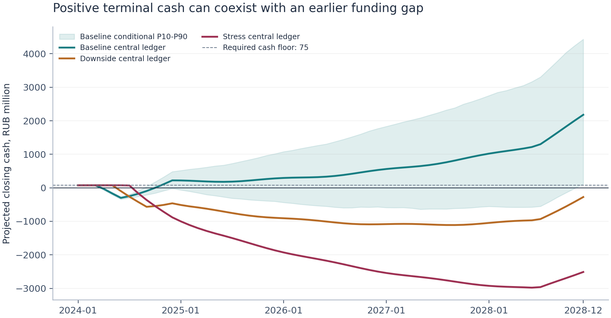

# Infra Cashflow Agent

[Русский](README.md) | [English](README.en.md)

Monthly infrastructure-project cash-flow forecasting: operating receipts, expenditure, debt service and unmet financing needs.

A project can earn money over its lifetime and run out of cash during construction. Contractors rarely accept a positive NPV in settlement of an invoice. This prototype therefore follows each month's cash balance, including the timing and limits of financing.

**Dmitry Kazakov | NEIMARK University, Nizhny Novgorod, Russia | Version 0.1.3**

The repository contains the implementation, a synthetic project, reproducible experimental results and research manuscripts. It is a research prototype. Forecast accuracy on real infrastructure projects and the decision quality of a live language-model planner have not been established.

## Quick start

Requirements: Git and Python 3.10 or newer. NumPy is installed with the package.

```bash
git clone https://github.com/dmkkazakov/-infra-cashflow-agent.git infra-cashflow-agent
cd infra-cashflow-agent
python -m venv .venv
source .venv/bin/activate
python -m pip install -e .
python -m infra_cashflow demo --output outputs/demo --simulations 1000 --seed 42
```

On Windows with `cmd`, activate the environment with `.venv\Scripts\activate.bat`.

The demo runs locally without a language-model API key. `outputs/demo/latest.json` identifies the latest successful run directory. That directory contains the report, monthly CSV files, scenario settings, input hashes and an action log.

To analyse a supplied project, prepare a JSON file using the [data dictionary](docs/DATA_DICTIONARY.md) and [JSON Schema](docs/project.schema.json), then run:

```bash
python -m infra_cashflow run examples/demo_project.json --output outputs/my-run --as-of 2023-12 --horizon 36 --simulations 1000 --seed 42
```

This command illustrates a 36-month horizon. The published scenario illustration uses the full period from January 2024 through December 2028.

## Results from the synthetic example

The project has a minimum cash target of RUB 75 million. The following figures are central ledger projections, rather than medians of simulated paths.

| Scenario | Minimum cash, RUB million | Peak shortfall to the RUB 75 million target | Terminal cash, RUB million |
|---|---:|---:|---:|
| Baseline | -301.23 | 376.23 | 2,178.67 |
| Downside | -1,111.18 | 1,186.18 | -275.52 |
| Stress | -2,979.18 | 3,054.18 | -2,511.79 |

Positive terminal cash in the baseline coexists with an earlier financing shortage. The peak shortfall is `75 - (-301.23) = 376.23` million. Monthly shortfall balances must not be added together as though each were a separate expenditure.



Negative projected cash records financing that is still needed. The engine does not automatically insert additional borrowing, equity or an authorised overdraft. Detailed reference outputs are in [results/demo](results/demo).

## What the harness does

The harness validates inputs, fixes the information cutoff, calls calculation tools, reconciles the ledger and records the result. It also controls which actions are allowed and when a run may be marked complete.

There are two execution modes:

- **Offline workflow.** A fixed sequence runs baseline, downside and stress scenarios, followed by four separate sensitivities: delay, CAPEX, receipts and interest rate. This mode produces the published financial experiment.
- **Optional LLM planner.** After the baseline is calculated, a language model chooses the order of permitted actions. It must complete downside and stress scenarios and at least one diagnostic before finalisation. Python performs the financial calculations and prepares the numerical report.

The planner cannot edit financial formulas, change financing commitments or execute arbitrary shell commands. Tool schemas, call budgets and required checks constrain its actions. One-factor sensitivities show the consequences of changed assumptions; they do not identify the causes of historical deviations.

The forecast combines three components:

1. **Project plan.** Monthly cash receipts, construction CAPEX, OPEX, cash taxes and maintenance CAPEX.
2. **Adjustment from observations.** Recent actual-to-plan ratios correct future components. A prior centred on one limits changes when the history is short.
3. **Cash and debt ledger.** Interest, principal payments and permitted facility drawings translate pre-financing cash flow into cash balances.

Monte Carlo simulation produces P10, P50 and P90 conditional on the chosen assumptions. Their coverage has not been calibrated on real project data. Simulated shortfall frequencies are not estimates of real-project default probability.

## Financial conventions

All amounts are in millions of one specified currency, RUB in the example. Inputs record cash payment and receipt dates, rather than accrued revenue or expenses.

```text
CFADS = receipts - opex - tax - maintenance_capex
FCF   = CFADS - capex
closing_cash = opening_cash + FCF + equity + debt_draw - interest - principal
closing_debt = opening_debt + debt_draw - principal
```

An additional working-capital adjustment is not deducted from these cash-based inputs, because that would count the difference between accrual and payment twice. CFADS definitions in a real financing agreement may differ and must be reconciled explicitly.

Interest is charged on opening debt at the annual rate divided by twelve. New drawings begin to accrue interest in the following month. The facility is non-revolving: repayment does not restore used commitment, and no new drawings are allowed after its availability date.

Future scheduled principal is capped by opening debt. An observed principal payment is preserved as an input; a payment above opening debt beyond machine rounding is rejected. Negative cash does not reduce scheduled debt service to manufacture a better coverage ratio.

The delay scenario shifts the remaining construction and operating cash schedules together. Equity, principal and facility-availability dates stay fixed. This represents a suspension of remaining activity, not every contractual consequence of delayed commissioning. Flows shifted beyond the horizon are disclosed separately.

Monthly DSCR is a diagnostic. A covenant calculation requires the definitions and aggregation period specified in the financing documents. Further assumptions and exclusions are in the [model card](docs/MODEL_CARD.md).

## Forecast evaluation and implementation checks

The experiment uses 12 seeded realisations of one synthetic project design, with four realisations in each of three regimes. It has 840 rolling forecast origins and 2,520 origin-target pairs at lead times of one, two and three months. The target is free cash flow before financing. Each forecast uses only observations available through its cutoff within the experiment.

| Method | MAE, RUB million | RMSE, RUB million |
|---|---:|---:|
| Unchanged plan | 20.68 | 25.11 |
| Last observation | 24.37 | 41.43 |
| Corrected plan | 10.29 | 13.75 |

The correction improves eight of twelve realisations and worsens all four unbiased-plan cases. These results describe the specified generator and evaluation window. The realisations are not a sample of independent infrastructure projects, and overlapping forecast windows are dependent. No incremental forecasting benefit of the LLM planner is measured.

Version 0.1.3 passed 96 tests on Python 3.10 and 3.12. An independent `Decimal` script recalculates all seven central scenarios and point-error metrics for all 12 realisations without invoking the financial engine or harness. A separate audit checked 200 random configurations covering 2,658 months; stochastic shocks were disabled in the vectorised comparison to isolate the accounting equations. See the [calculation review](docs/CALCULATION_REVIEW.md), [reference audit](results/independent_audit.json) and [version 0.1.3 verification report](docs/VERIFICATION.md).

The reference files under `results/` retain their original version 0.1.1 provenance. Version 0.1.3 fixes invalid-input handling, numerical boundaries and runtime failures without changing the financial assumptions or published experimental figures. The [changelog](CHANGELOG.md) records these changes.

## Lessons from repeated runs and failures

A successful demonstration did not cover all the conditions needed for a reliable run. The subsequent audit corrected several state-management issues:

- A failed attempt could retain partial results and tool-call identifiers. Retries now start with clean attempt state; changed inputs or settings require a new harness instance and run identity.
- An existing manifest did not necessarily represent a complete result. Cache reuse now checks identity, required artifacts and their hashes, including the expected scenario and diagnostic set.
- Failure while publishing the latest-run pointer could leave an unsuccessful attempt marked complete. A failed new attempt now removes that completion marker and records failure.
- Mutable scenario settings and returned reports could share objects with external code. The harness now copies these structures so later changes do not alter a completed calculation.

Numerical corrections also reject non-finite intermediate calculations and prevent positive drawings from zero headroom or after facility expiry. Credential validation rejects malformed keys before an HTTP request and avoids including their values in error messages.

A complete adapter-to-harness cycle was checked against a local HTTP server with scripted responses. The first response deliberately requested premature finalisation. The harness rejected it; a rate diagnostic, the two required scenarios and report persistence then completed in five requests. This verifies the integration contract, not the decisions of a live language model.

## Reproduce the published calculations

Run these commands from the repository root after installation. New files go to `outputs/reproduction` and `outputs/additional-audits`, preserving the frozen `results/` files and the versioned example.

```bash
python -m unittest discover -s tests -v
python scripts/generate_demo.py --output outputs/reproduction/demo_project.json --benchmark --benchmark-output outputs/reproduction/benchmark.json
python -m infra_cashflow demo --output outputs/reproduction/demo --simulations 1000 --seed 42
python scripts/audit_release.py --demo-dir outputs/reproduction/demo --output outputs/reproduction/audit.json
python scripts/audit_randomized.py
python scripts/audit_http_harness.py
```

The generator creates a new synthetic fixture and repeats the 12-seed benchmark. The audit independently recalculates the fresh central forecasts and checks point-error metrics against the published `results/benchmark.json`. It does not assess uncertainty-band calibration.

The two supplementary scripts reproduce the random-configuration arithmetic checks, the nine-setting backtest comparison and the five-request local HTTP test. They write to `outputs/additional-audits/`. The HTTP check uses a loopback server, scripted responses and a dummy credential. [Recorded results and script hashes](docs/verification/extra_audits_v013.json) specify the scope of these checks.

To audit the frozen reference forecast separately:

```bash
python scripts/audit_release.py --output outputs/reference-audit.json
```

For rolling-origin evaluation of a supplied data set:

```bash
python -m infra_cashflow evaluate examples/demo_project.json --output outputs/evaluation.json --min-train 12 --horizon 3
```

The demo retains future actuals for evaluation, but forecasting excludes rows after `as_of`. The input format records economic months and one plan vintage; it does not retain the availability timestamp of every fact or a history of plan revisions. Evaluation on real data requires source records that were actually available at each forecast date.

## Connect a language model

LLM mode requires a server with a Chat Completions-compatible API and tool-call support. For a local server:

```bash
export CASHFLOW_LLM_BASE_URL="http://localhost:8000/v1"
export CASHFLOW_LLM_MODEL="your-tool-capable-model"
python -m infra_cashflow run examples/demo_project.json --mode llm --allow-network --output outputs/llm-run --objective "Find the strongest liquidity risk drivers"
```

For an external provider, set an HTTPS API endpoint and supply the key through `CASHFLOW_LLM_API_KEY`. Plain HTTP is permitted only for a loopback address. Network access requires `--allow-network`; the configured endpoint receives the objective and calculated summaries. Raw contracts and the full actuals history are not included in the planner payload.

The adapter has been checked with mocked responses and the scripted local HTTP integration test described above. No live language-model call was used for the reported experiment. Model or transport failure causes the run to fail rather than publish an unchecked result.

## Scope and practical limits

The prototype supports monthly periods, one currency and one debt facility. It does not include a detailed tax or VAT model, daily liquidity, multiple debt tranches, hedging, reserve accounts, financing fees, capitalised interest, dividends, contractual covenant interpretation or an automatically inferred construction network.

Zero future plan values remain zero after multiplicative adjustment. New expenditure and changed project milestones require explicit schedule updates. Hashes support reconstruction and detection of changes relative to a manifest; they do not establish that the input records are true, and the manifests are not signed records.

GitHub stores the code and runs verification on pushes and pull requests. This repository does not deploy a continuously running forecasting service, an accounting-system connector or a scheduled data-ingestion process.

## Publications and documentation

- [Publication index and version notes](docs/publications/README.md).
- [English working paper](docs/publications/ssrn_paper.md) and [English PDF](docs/publications/Infra_Cashflow_SSRN_Dmitry_Kazakov.pdf).
- [Russian companion manuscript](docs/publications/ssrn_paper_ru.md) and [Russian PDF](docs/publications/Infra_Cashflow_SSRN_Dmitry_Kazakov_RU.pdf).
- [Russian Habr article on cash flow and the experience with the harness](docs/publications/habr_article.md).
- [Model card](docs/MODEL_CARD.md), [data dictionary](docs/DATA_DICTIONARY.md) and [JSON Schema](docs/project.schema.json).

The paper was posted on SSRN on 30 October 2026: [SSRN 7666020](https://papers.ssrn.com/sol3/papers.cfm?abstract_id=7666020), DOI **10.2139/ssrn.7666020**. SSRN posting is not peer review. Revised repository PDFs include the current author affiliation; replacing SSRN-hosted files requires an authenticated author revision.

Source code is in `src/infra_cashflow`, tests in `tests`, example data in `examples`, and reproduction scripts in `scripts`.

Publication dependencies can be installed with `python -m pip install -e ".[publication]"`. `python scripts/render_figures.py` rebuilds figures. `python scripts/build_publications.py` creates Word documents from the publication sources under `outputs/publications` by default. Use `--target ssrn` for the English working paper or `--target ssrn-ru` for its Russian companion; `--output-dir` selects another destination. PDF export is a separate step.

## References

- [World Bank PPP Resource Center: project finance and DSCR](https://ppp.worldbank.org/financing/issues-in-project-financed-transactions).
- [Hyndman and Athanasopoulos: Forecasting Principles and Practice](https://otexts.com/fpp3/toolbox.html).
- [Anthropic: Building effective agents](https://www.anthropic.com/research/building-effective-agents).
- [Anthropic: Effective harnesses for long-running agents](https://www.anthropic.com/research/effective-harnesses-for-long-running-agents).

## License

Copyright 2026 Dmitry Kazakov. Source code is released under the [MIT License](LICENSE). The author retains rights to the article texts.
