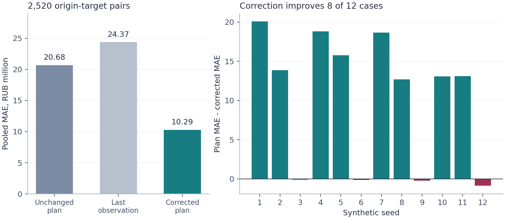

# Infrastructure Cash Flow Forecasting with a Bounded Agent Harness

**Evidence from a Synthetic Benchmark and Software Verification**

**Dmitry Kazakov**

dmkkazakov@gmail.com

Working paper. Revised 24 October 2026.

## Abstract

Infrastructure cash-flow forecasting combines uncertain project performance with contractual financing limits and operational software risks. This paper separates three questions: whether the cash-and-debt ledger is correct, whether an adaptive correction improves the plan, and whether a bounded agent harness preserves valid results through incomplete actions and failed runs. Twelve seeded realisations of three synthetic regimes provide 840 rolling forecast origins and 2,520 origin-target pairs over one- to three-month horizons. For cash flow before financing, the corrected plan achieves mean absolute error of RUB 10.29 million, against RUB 20.68 million for the unchanged plan. Correction improves eight realisations but worsens all four cases with no systematic component bias. A separate scenario calculation produces a peak funding gap of RUB 376.23 million despite positive terminal cash. Verification of software version 0.1.3 includes 96 tests, a separate Decimal recalculation and 200 random configurations. Failure analysis identifies premature completion markers, state retained across retries, mutable configuration aliases, invalid cache reuse and numerical boundary errors. A five-request scripted HTTP test checks rejection of premature finalisation and subsequent completion. No live language-model planner or real-project forecast performance is evaluated. The contribution is reproducible evidence about the estimator and the execution conditions required to retain reviewable financial results, including negative findings.

**Keywords:** infrastructure finance; cash-flow forecasting; project finance; agent harness; software verification; scenario analysis; time-series evaluation.

**JEL classification:** C53; C63; G32.

## 1. The forecasting problem

Positive lifetime value does not ensure that a project can meet each payment when it falls due. Construction outflows may precede operating receipts, while credit availability can expire before delayed work is completed. A useful forecast must therefore connect project performance with the timing and limits of financing.

The World Bank distinguishes construction, operating, demand and collection risks [2]. Its project-finance guidance defines periodic debt-service coverage by relating available cash to interest and principal obligations over the same period [1]. These distinctions guide the model's economic structure.

Construction cash-flow research has examined risks associated with differences between forecasts and actual payments, including evidence from contractor surveys [7]. Zayed and Liu combine analytic hierarchy process and simulation to examine contractor cash-flow factors, including payment timing and project delays [8]. These studies support making timing and payment assumptions explicit. They do not calibrate the present model, which follows a project company through construction and operation.

The study asks three separate questions. First, does the implementation preserve cash, debt and contractual financing constraints? Second, when does a correction based on observed component deviations improve the existing plan? Third, what must remain true when the tool-execution process is interrupted, repeated or given an invalid completion request? Each question requires different evidence. Accounting reconciliation cannot establish forecasting skill, and a lower forecast error cannot establish reliable persistence.

The method combines established techniques. Its contribution is a reproducible synthetic comparison together with a documented analysis of numerical and execution failures. The revised manuscript includes the additional verification of software version 0.1.3 [9]. It makes no claim to introduce a new general forecasting algorithm or to establish the value of an autonomous language-model planner.

## 2. Cash and debt model

Let s denote the forecast origin and t a subsequent month. R_t denotes operating cash receipts, O_t cash operating expenditure, Tax_t cash taxes, M_t maintenance CAPEX and K_t construction CAPEX. Financing comprises equity E_t, debt drawings D_t, interest I_t and principal service P_t. C_t and B_t are closing cash and debt.

`CFADS_t = R_t - O_t - Tax_t - M_t`.

`FCF_t = CFADS_t - K_t`.

`C_t = C_(t-1) + FCF_t + E_t + D_t - I_t - P_t`.

`B_t = B_(t-1) + D_t - P_t`.

`DSCR_t = CFADS_t / (I_t + P_t)`.

The chosen CFADS definition deducts maintenance CAPEX and excludes construction CAPEX. A transaction-specific implementation must follow the financing documents, including their treatment of reserves and adjustments. Equity and borrowing provide liquidity but do not enter operating receipts or CFADS.

Interest equals opening debt multiplied by the nominal annual rate divided by twelve. Month-end drawings affect interest from the following month. Future scheduled principal is capped by opening debt. An observed principal payment exceeding opening debt beyond the bounded allowance for machine rounding is rejected, including when historical drawings and interest must be reconstructed. Cash shortage does not reduce scheduled service to manufacture a better DSCR. Where service is zero, DSCR is null; the implementation uses a denominator threshold of 1e-12 in the stated million-unit scale.

The facility is non-revolving: headroom depends on cumulative drawings, and repayment does not restore commitment. Drawings also cease after the availability date. The monthly funding gap is max(cash target - closing cash, 0), and its reported peak is the maximum across months. Monthly gaps are stocks and must not be summed as new expenditures. A gap can occur while cash remains positive. Negative projected cash records unmet financing; the engine does not insert uncommitted equity, refinancing or an authorised overdraft.

Monthly DSCR is a diagnostic. A covenant may require a different cash definition and quarterly, semiannual, annual or forward-looking aggregation. Cash and obligations should be aggregated to that period; averaging monthly ratios generally gives a different answer.

## 3. Information and estimation

### 3.1 Data available at each origin

The inputs comprise a frozen plan p_(j,t) and observed components x_(j,t). Only observations through s enter correction estimates and starting-state reconstruction. Future synthetic outcomes are retained for evaluation.

Plan revisions also carry information. Using a later revised plan at an earlier origin introduces hindsight even if future actuals are excluded. The experiment fixes the plan before generating observations. The current schema checks the plan vintage and filters actuals by economic month, but does not store each observation's availability timestamp or a history of plan revisions. Reporting lags and historical availability must be controlled upstream.

Inputs use nonnegative amounts for separately identified inflows and outflows, all in millions of roubles. Validation checks dates, ordering, required fields, numerical finiteness and financing parameters. Recorded historical drawings and interest can be supplied; otherwise the model reconstructs financing and flags that assumption. Input hashes, settings, the cutoff and software version allow reconstruction of a run, without certifying the truth of the source records.

### 3.2 Component correction

For planned component values above 1e-9 in the stated million-unit scale, define:

`r_(j,t) = x_(j,t) / p_(j,t)`.

The estimator retains the twelve most recent eligible observations, which need not be consecutive calendar months, and clips ratios to [0, 5], recording the number clipped. Let n be the number of retained observations. Starting from the newest eligible observation, unnormalised weights begin at one and decrease by a factor of 0.85 for each older observation. They are then normalised to sum to n. A prior weight of three at ratio one limits changes supported by a short history:

`m_(j,s) = 1 + lambda_(j,s) * (rbar_(j,s) - 1)`,

`lambda_(j,s) = n / (n + 3)`.

The barred ratio is the weighted mean of clipped ratios. This is a shrinkage heuristic, not a formally established Bayesian posterior. Future component forecasts equal the scenario-adjusted plan multiplied by m_(j,s). When n is zero, the multiplier is one. The rule applies separately to receipts, construction CAPEX, OPEX, cash taxes and maintenance CAPEX. Equity and principal schedules remain explicit commitments or scenario assumptions.

This estimator can track persistent deviations, but it does not identify their causes. Before operations begin, there is no project-specific receipt history to learn from. Multiplication also preserves a zero future plan value, so unexpected expenditure or a new commissioning date requires an explicit schedule change. The numerical ledger can be retained when replacing this baseline with a different estimator.

## 4. Scenarios and uncertainty

The delay_months parameter shifts all remaining construction and operating cash schedules, including CAPEX, receipts, OPEX, taxes and maintenance. Equity, principal dates and facility availability remain fixed. It represents a suspension of remaining activity, not every possible form of commissioning delay.

The CAPEX multiplier affects construction and maintenance expenditure. Receipt and OPEX multipliers and an annual-rate shift are separate inputs. Cash taxes follow the supplied shifted schedule and are not automatically recomputed from changes in receipts or costs. Collection lags, work-package dependencies, standby costs, penalties and compensation require more detailed schedules. Any cash flows shifted beyond the reporting horizon are disclosed separately, so a deferred obligation is not mistaken for a saving.

For uncertainty analysis, correlated lognormal perturbations modify projected components before they enter the financial equations. Normal innovations combine common and component-specific factors, with common variance share 0.35. A stationary AR(1) process with coefficient 0.65 supplies temporal dependence. A persistent perturbation represents uncertainty in the component multiplier. The exponent adjustment gives multiplicative shocks unit expectation under this Gaussian construction.

Relative dispersion of historical ratios provides a heuristic log-noise scale, subject to component floors and a ceiling of 0.60. The floors are 0.05 for receipts, 0.06 for construction CAPEX, 0.04 for OPEX, and 0.05 for taxes and maintenance. With active observations, the persistent parameter scale equals the component scale divided by the square root of n + 3. Without history, the component and parameter scales are both set to 0.12 for receipts, 0.10 for construction CAPEX, 0.08 for OPEX, and 0.10 for taxes and maintenance. These settings are demonstration assumptions, not an estimated structural model of infrastructure risk.

The tenth and ninetieth percentiles define a central 80% interval within the simulated distribution. Empirical coverage requires separate out-of-sample evaluation [4]. Frequencies of simulated funding gaps are not real-project default probabilities. Moreover, marginal monthly quantiles can originate from different paths. Financial equations are applied to complete paths before quantiles are extracted; component quantiles cannot simply be added into a coherent cash scenario. Shared random draws and fixed seeds make scenario comparisons reproducible.

## 5. What the harness controls

The harness provides a deterministic local workflow and an optional planner through a compatible HTTP model interface. This distinction matters: a workflow follows prescribed paths, while a model-directed agent chooses actions [3]. The local workflow reproduces the financial experiment without contacting a model.

Both modes require validation, the information cutoff, baseline calculation and reconciliation. Diagnostic tools compare the baseline with a three-month suspension, a 10% CAPEX increase, a 10% receipt reduction or a two-percentage-point annual-rate increase. These are sensitivities to specified assumptions, not causal explanations of observed outcomes.

The local mode runs all four diagnostics. The optional planner must complete downside and stress scenarios and inspect at least one driver. Tool schemas and call limits constrain its actions. It cannot change the financial arithmetic, invent financing, execute arbitrary shell code or bypass failed checks. Network access is opt-in.

Reports use structured numerical outputs. Evidence pointers identify four key metrics for each scenario; this is not a field-by-field citation system for every number in the report. Free-form model numbers do not replace calculated values. Each run preserves machine-readable results, a summary and an action log. External state and progress records are consistent with engineering guidance for long-running agents [5].

Inputs and settings are fixed for the lifetime of a harness instance. Changes require a new instance and run identity. A cached result is usable only if its identity, expected files and recorded hashes agree. A failed attempt must not leave a new successful-completion marker, and a retry must clear partial attempt state. These are operational acceptance conditions, not consequences of the language model's explanation.

The default planner budget is eight rounds, with an allowed maximum of twelve, and each response must select one permitted tool call. In network-enabled mode, the endpoint receives the objective and calculation summaries. A hash establishes consistency with a manifest; it does not authenticate the original source data or make a log tamper-proof against replacement of both the files and manifest. The tests below examine specific failure modes rather than certifying general security, crash durability or concurrent access.

## 6. Experiment design

### 6.1 Synthetic projects

The experiment comprises twelve seeded realisations of one template, each covering 84 months from January 2022 through December 2028: 30 construction months and 54 operating months. The frozen plan is dated December 2021. The default illustration uses a December 2023 cutoff.

Planned construction CAPEX totals RUB 6,000 million, with RUB 2,000 million of initial equity. Opening cash is RUB 100 million, the facility limit RUB 4,700 million and the cash target RUB 75 million. The annual rate is 12%; availability ends in December 2024. Principal service of RUB 110 million per month starts in January 2025, capped by outstanding debt.

Operating receipts ramp toward RUB 260 million per month before 2% annual escalation and 6% sinusoidal seasonality. Operating and maintenance expenses follow specified schedules. The generator's 12% cash-tax proxy is illustrative and does not represent a statutory rate.

Seeds one through twelve supply four realisations of each regime. The unbiased regime centres component deviations on one. Persistent bias uses receipt multipliers between 0.89 and 0.95 and construction CAPEX multipliers between 1.08 and 1.15, with separate deviations for other components. The reversal regime begins similarly but changes receipt bias to 1.07 from January 2027 and resets other operating biases to one.

Synthetic observations use lognormal perturbations with AR(1) coefficient 0.45, common innovation variance share 0.25 and component scales from 0.025 to 0.045. The generator starts its autoregressive state at zero, creating an initial transient; the forecast simulation instead starts from a stationary normal innovation. Thus the generator differs from the forecast simulation, although its multiplicative structure favours the correction rule. These are twelve realisations of one artificial design, not twelve independently sampled infrastructure projects. The design was not externally preregistered.

### 6.2 Evaluation

Three methods use identical forecast origins: the unchanged plan, repetition of the last observed components, and the corrected plan. Rolling-origin evaluation refits the correction using only preceding observations [4]. After twelve initial months, each origin contributes lead times of one, two and three months. Seventy origins per realisation, from December 2022 through September 2028, produce 840 origins and 2,520 origin-target pairs. Scores pool all three lead times.

The target is cash flow before financing, preventing debt drawings from concealing operational forecast error. For e_i = yhat_i - y_i:

`MAE = mean(abs(e_i))`.

`RMSE = sqrt(mean(e_i^2))`.

Both metrics are in millions of roubles. Component WAPE divides total absolute error by total absolute actual values when the denominator is positive. Percentage errors are less useful for net flows near zero or changing sign. Pooled RMSE uses all squared errors rather than averaging project-level RMSE. Overlapping origins and target months are dependent; the reported scores do not imply independent-sample confidence intervals.

Quantile calibration is outside this experiment. A later study should assess coverage and pinball loss. At quantile level τ, this loss equals τ times positive underprediction error plus (1 - τ) times positive overprediction error [6]. Under this convention, median pinball loss equals one-half of MAE.

## 7. Results

### 7.1 Point-forecast accuracy

**Table 1. Pooled errors, RUB million**

| Method | MAE | RMSE | Origin-target pairs |
|---|---:|---:|---:|
| Unchanged plan | 20.6776 | 25.1087 | 2,520 |
| Last observation | 24.3748 | 41.4297 | 2,520 |
| Corrected plan | 10.2911 | 13.7464 | 2,520 |



**Figure 1.** Forecast errors for twelve seeded realisations of the synthetic design.

The corrected plan reduces pooled MAE by 50.23% relative to the unchanged plan. This percentage describes the chosen generator, regime mixture and evaluation window. It is not an expected gain for a real portfolio.

**Table 2. Errors by regime, RUB million**

| Regime | Method | MAE | RMSE |
|---|---|---:|---:|
| Persistent component bias | Unchanged plan | 28.4082 | 30.8653 |
| Persistent component bias | Last observation | 23.0518 | 40.3450 |
| Persistent component bias | Corrected plan | 10.7621 | 13.5408 |
| Operating regime reversal | Unchanged plan | 25.8197 | 28.8220 |
| Operating regime reversal | Last observation | 25.5222 | 41.7177 |
| Operating regime reversal | Corrected plan | 11.9675 | 16.3867 |
| Unbiased noisy plan | Unchanged plan | 7.8049 | 10.3906 |
| Unbiased noisy plan | Last observation | 24.5505 | 42.2038 |
| Unbiased noisy plan | Corrected plan | 8.1436 | 10.7245 |

Each regime contributes four realisations and 840 pairs. Correction improves eight of twelve realisations but worsens all four unbiased cases. Their pooled MAE increases from 7.8049 to 8.1436 million, a 4.34% deterioration within that group. Adaptation carries a cost when random deviations are mistaken for persistent signals. The all-case improvement and the unbiased-group deterioration are both central results.

The last-observation benchmark ignores the known transition from construction to operations. Its resulting errors make the unchanged plan the more informative comparator. No neural-network, gradient-boosting or foundation-model forecaster was evaluated. Full origin-level results and component WAPE are retained in the machine-readable report.

### 7.2 Liquidity scenarios

The illustration uses seed seven, a December 2023 cutoff and forecasts through December 2028. At the cutoff, cash is RUB 75 million and debt RUB 4,110.4358 million. The downside combines a three-month suspension, receipt multiplier 0.90, CAPEX multiplier 1.10, OPEX multiplier 1.05 and annual-rate increase 0.02. Stress uses six months, multipliers 0.80, 1.20 and 1.10 respectively, and rate increase 0.04.

**Table 3. Point-projection outcomes, RUB million**

| Scenario | Minimum cash | Peak gap to cash target | Terminal cash | Minimum operating DSCR |
|---|---:|---:|---:|---:|
| Baseline | -301.2287 | 376.2287 | 2,178.6664 | 0.9252 |
| Downside | -1,111.1786 | 1,186.1786 | -275.5203 | 0.6948 |
| Stress | -2,979.1790 | 3,054.1790 | -2,511.7870 | 0.3013 |


**Figure 2.** Central cash projections and conditional simulation bands under the specified scenarios.

With a RUB 75 million reserve target, the peak gap equals 75 minus the minimum projected cash: 75 - (-301.2287) = RUB 376.2287 million in the baseline. These are point-component ledger results, not simulated medians. Constrained drawings make the financing calculation nonlinear, so cash calculated from expected components need not equal expected cash across simulations.

Positive baseline terminal cash coexists with an earlier shortage. The reported minimum DSCR covers operating months after effective commissioning; the output also retains an all-period diagnostic. Downside defers RUB 801.0833 million of receipts beyond December 2028, while stress defers RUB 1,407.1310 million. Associated expense tails are disclosed too. Terminal comparisons therefore depend on the horizon.

The simulation uses 1,000 paths and random seed 42. Every path in each of the three scenarios crosses below zero in this run. This is a conditional simulation frequency, not evidence that a real project will certainly default.

### 7.3 Numerical and integration verification

The release evidence for version 0.1.3 records 96 passing tests, including CI on Python 3.10 and 3.12 [9]. They cover ledger identities, financing constraints, information cutoffs, extreme numerical inputs, state recovery and scripted planner interactions. A standalone reference script uses 40-digit Decimal arithmetic to recalculate all seven central scenarios and all twelve benchmark cases without calling the financial ledger or harness. It shares the synthetic fixtures, so this is a separate arithmetic implementation rather than an independent data collection.

An additional audit compares 200 random configurations covering 2,658 months with a 50-digit Decimal reference. The largest scalar discrepancy is about 1.82e-12 in the input money unit. In the vectorised comparison, stochastic shocks were disabled to isolate accounting logic. Nine additional minimum-history and forecast-horizon settings were also compared; the largest metric discrepancy was about 4.26e-14. These checks do not independently validate all stochastic paths or interval calibration.

A local HTTP server supplied five scripted model responses. The first deliberately requested finalisation before the required scenarios and diagnostics. The harness rejected it, reported the missing steps, accepted a rate diagnostic and the two mandatory scenarios, and then saved a completed report. This establishes protocol handling and completion gating for that sequence. It is not evidence that a live model selected useful actions, reduced analyst time or improved a forecast.

The published central forecasts, reconciliation checks and sensitivities are unchanged from the frozen 0.1.1 experiment. The 0.1.3 changes repair invalid-input handling, numerical boundary behaviour and orchestration failures. Installation was also checked in an isolated environment. Passing this collection of tests is evidence about specified cases, not a proof that all defects have been eliminated.

## 8. Failure analysis and acceptance criteria

### 8.1 Completion must survive the save procedure

A successful numerical calculation can still produce an invalid operational result. During verification, an exception while writing the latest-result pointer could leave a new attempt marked complete. Failure logging then changed an artefact after its manifest hash had been recorded, so a retry encountered an inconsistent cache. The correction removes the new successful marker when persistence fails and keeps failure handling consistent with the files left behind.

This case changes the acceptance question. A result is not complete merely because a forecast object exists or the planner requested finalisation. Required calculations and reconciliations must have finished, and the prescribed persistence procedure must have succeeded. The implementation is tested against this injected write failure; durability under power loss and competing writers remains outside the claim.

### 8.2 Retries and cache reuse need explicit identity

A second defect retained tool-call identifiers and partial results in a harness object after a failed attempt. Reusing that object could therefore contaminate a later attempt. Attempt state is now cleared on retry. Inputs and configuration are snapshotted, while changed inputs require a new instance. Scenario objects and returned report structures are copied so that external mutation cannot silently modify the internal configuration or result.

Cache validation checks more than the presence of a manifest. The expected files, hashes, parameters and provenance must agree. A separate A, B, A sequence showed why the latest-result pointer also matters: after computing A, computing B and reusing cached A, the pointer must again identify A. Correct financial values alone did not prevent selection of the wrong most recent result.

### 8.3 Numerical and transport boundaries affect financial meaning

A historical principal payment of 50 against opening debt of 40 was previously capable of being handled like a future schedule and reduced to 40. A forecast schedule may be capped, but an observed payment cannot be silently rewritten. The current implementation preserves the supplied amount and rejects the inconsistent history beyond a bounded allowance for machine rounding.

A fixed numerical tolerance also permitted a tiny positive borrowing amount against a zero limit. Tightening the boundary prevents rounding policy from creating financing. Extreme finite inputs revealed intermediate overflow, including a WAPE denominator that could become infinite and produce a false zero error. Finiteness is now checked during computation rather than only at input validation.

Transport testing used an artificial API key containing an invalid line break. Early validation and sanitised error messages prevent that value from appearing in the exception. This is a specific error-path check, not evidence that a live provider connection or all forms of secret handling were assessed.

**Table 4. Selected failure cases and the acceptance conditions added**

| Observed case | Acceptance condition | Evidence boundary |
|---|---|---|
| Failure while saving the latest pointer | No new successful marker survives failed persistence | Injected write failure |
| Retried harness retains partial state | A new attempt starts without prior tool identifiers or partial results | Same-instance retry |
| Mutable configuration or report alias | External mutation does not alter stored internal objects | Mutation regression cases |
| Corrupt cache or A, B, A reuse | Cache contents are validated and latest identifies the selected run | File and sequence checks |
| Historical payment exceeds debt | Reject inconsistent facts without rewriting amounts | Ledger boundary cases |
| Positive draw against a zero limit | Rounding cannot create borrowing capacity | Zero-limit and expiry cases |
| Intermediate numerical overflow | Fail clearly instead of reporting non-finite or false-zero output | Extreme finite inputs |
| Invalid credential formatting | Reject before HTTP and keep the value out of the error | Artificial credential only |

The failure cases were selected during targeted review of this implementation. Their count does not estimate the incidence of defects in other harnesses. The transferable lesson is a testable separation of arithmetic, information availability, tool permissions and persisted state. Whether a model has described the result persuasively is not an acceptance criterion.

## 9. Implications and next steps

The prototype makes several consequential assumptions visible. Borrowing cannot be counted as operating income; principal repayment cannot restore a non-revolving commitment; a delay cannot silently extend credit availability. Deferred obligations remain visible beyond the forecast horizon. These rules make a funding alert traceable to the cash component, date and financing constraint that produced it.

Scope remains limited to a monthly, single-currency model with one simplified facility. Fees, daily accrual, multiple tranches, hedging, reserve accounts, dividend restrictions, detailed taxation and automatic refinancing are excluded. The model reads structured schedules, not contracts or construction imagery. Neither a correct ledger nor a low synthetic error removes the need to verify source data and transaction definitions.

The next empirical test should use dated plan versions and cash histories from several infrastructure sectors, reserving projects and periods for untouched evaluation. Besides average error, it should examine the largest liquidity-shortfall months, warning lead time and empirical quantile coverage. Reporting-lag timestamps, revised plans and the exact contractual CFADS definition are prerequisites for that evaluation.

A separate live-model experiment should compare the fixed workflow with a model-directed planner on the same cases, permitted tools and information. It should measure whether the chosen diagnostics identify material liquidity drivers, whether conclusions agree with calculation evidence, and what calls, latency and cost are required. An improvement in this process would still need to be distinguished from an improvement in the numerical forecaster. Neither comparison has yet been performed.

A practical consequence of the negative unbiased-plan result is that adaptation should itself be evaluated against a credible frozen-plan baseline. The present study does not test a gate for switching correction on and off. Any such rule would require a separate development sample and an untouched evaluation sample; selecting a rule from these twelve cases and reporting the same cases as a test would overstate the evidence.

The current evidence supports a narrower conclusion: the implementation can expose unmet financing, preserve accounting identities and reconstruct a forecast from recorded inputs. Its adaptive rule helps under persistent synthetic deviations but can damage an already useful plan. Establishing practical forecasting value requires historical project evidence.

## Generative AI assistance

OpenAI GPT-6 Astra Pro assisted with literature discovery, software implementation, test development, computational verification support, drafting, editing and translation. Its contribution was substantial. Reported numerical results come from the executable synthetic experiment and the specified arithmetic checks, not from free-form language-model forecasts. The author is responsible for the final manuscript, interpretations and submission. No claim is made that the forecast benchmark evaluated a live language-model planner.

## References

[1] World Bank. Key Issues in Developing Project Financed Transactions. PPP Resource Center. [Source](https://ppp.worldbank.org/financing/issues-in-project-financed-transactions). Accessed 24 October 2026.

[2] World Bank. Identifying Risks. PPP Resource Center. [Source](https://ppp.worldbank.org/identifying-risks). Accessed 24 October 2026.

[3] Anthropic. Building effective agents. 19 December 2024. [Source](https://www.anthropic.com/research/building-effective-agents). Accessed 24 October 2026.

[4] Hyndman, R. J., and Athanasopoulos, G. Forecasting: Principles and Practice, third edition, Chapter 5: The forecaster's toolbox. OTexts. [Source](https://otexts.com/fpp3/toolbox.html). Accessed 24 October 2026.

[5] Anthropic. Effective harnesses for long-running agents. 26 November 2025. [Source](https://www.anthropic.com/research/effective-harnesses-for-long-running-agents). Accessed 24 October 2026.

[6] scikit-learn developers. Mean pinball loss. [Documentation](https://scikit-learn.org/stable/modules/generated/sklearn.metrics.mean_pinball_loss.html). Accessed 24 October 2026.

[7] Odeyinka, H. A., Lowe, J., and Kaka, A. (2008). An evaluation of risk factors impacting construction cash flow forecast. Journal of Financial Management of Property and Construction, 13(1), 5-17. [doi:10.1108/13664380810882048](https://doi.org/10.1108/13664380810882048).

[8] Zayed, T., and Liu, Y. (2014). Cash flow modeling for construction projects. Engineering, Construction and Architectural Management, 21(2), 170-189. [doi:10.1108/ECAM-08-2012-0082](https://doi.org/10.1108/ECAM-08-2012-0082).

[9] Kazakov, D. (2026). Infra Cashflow Agent version 0.1.3. Software, tests and verification record. [Code and verification](https://github.com/dmkkazakov/-infra-cashflow-agent/tree/2fa489170fb4e0700069e6369e80853d221c7cfe). Accessed 24 October 2026.

## Appendix A. Reproduction and provenance

The repository contains source code, synthetic fixtures, tests and machine-readable experimental outputs. The package version is 0.1.3. Its verified code snapshot is commit 2fa489170fb4e0700069e6369e80853d221c7cfe. The frozen files under results/ retain their original version 0.1.1 provenance. Version 0.1.3 reproduces the published central forecasts, reconciliation checks and sensitivities without changing those files. The paper, its Russian companion and both README versions describe the same experiment.

No confidential client or borrower data are included. All monetary examples use RUB million. The financial experiment requires no model API key or external model call. From the repository directory:

```bash
python -m pip install -e .
python -m unittest discover -s tests -v
python -m infra_cashflow demo --simulations 1000 --seed 42 \
  --output outputs/reproduction/demo
python scripts/generate_demo.py \
  --output outputs/reproduction/demo_project.json \
  --benchmark --benchmark-output outputs/reproduction/benchmark.json
python scripts/audit_release.py --demo-dir outputs/reproduction/demo \
  --output outputs/reproduction/audit.json
python scripts/audit_randomized.py
python scripts/audit_http_harness.py
```

The latest.json pointer under outputs/reproduction/demo identifies the successful run directory. The generator separately reconstructs the benchmark under outputs/reproduction. The Decimal audit reads the fresh forecast selected by --demo-dir and the frozen benchmark under results/benchmark.json. It does not silently substitute the newly generated benchmark file. To compare the latter, use the corresponding aggregate metrics and per-realisation error totals.

The two supplementary audit scripts were added with this manuscript revision. They reproduce the 200-configuration arithmetic check, the nine-setting backtest comparison and the five-request HTTP test against the unchanged version 0.1.3 implementation. Their outputs are written under outputs/additional-audits/. The HTTP test uses a local loopback server with scripted responses and a dummy credential. Script hashes and recorded results are provided in docs/verification/extra_audits_v013.json.

**Table A1. Primary evidence in the repository**

| Evidence | Location | Interpretation |
|---|---|---|
| Synthetic template and generator | examples/demo_project.json; src/infra_cashflow/data.py | Demonstration design, not observed infrastructure data |
| Forecast comparison | results/benchmark.json | Twelve seeded cases and three pooled lead times |
| Scenario calculations | results/demo/latest.json and its run directory | Frozen scenario artefacts with original provenance |
| Decimal reference | scripts/audit_release.py; results/independent_audit.json | Separate arithmetic check using shared fixtures |
| Release verification | docs/VERIFICATION.md; tests/ | Numerical, retry, cache and protocol cases |
| Supplementary audits | scripts/audit_randomized.py; scripts/audit_http_harness.py | Reproducible random-configuration, backtest and local HTTP checks |
| Continuous integration | .github/workflows/tests.yml | Tests, saved-result audit, fresh forecast, backtest and supplementary audits |

Reproducing a calculation confirms the recorded computation. It does not establish whether the source assumptions match a particular asset, whether a real forecast interval is calibrated, or whether a live planner makes useful decisions.
