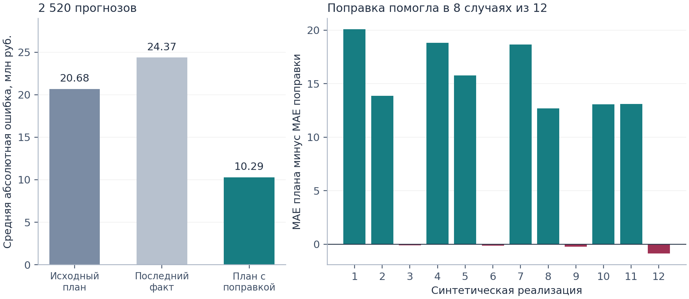
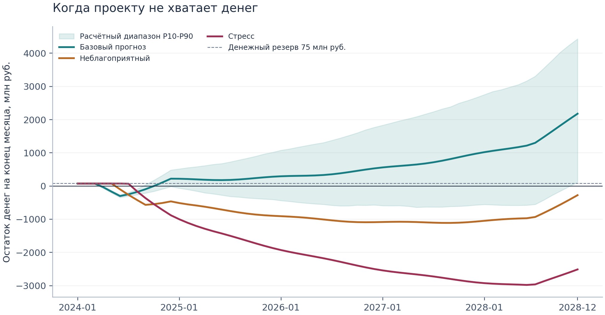

# Прогнозирование денежных потоков инфраструктурного проекта с агентным harness

**Синтетический эксперимент и результаты проверки программной реализации**

**Дмитрий Казаков**

Университет НЕЙМАРК, Нижний Новгород, Россия

dmkkazakov@gmail.com

Аффилиация обновлена 30 октября 2026 года. SSRN: https://papers.ssrn.com/sol3/papers.cfm?abstract_id=7666020. DOI: 10.2139/ssrn.7666020.

Рабочая статья. Редакция от 24 октября 2026 года.

## Аннотация

Прогнозирование денежных потоков инфраструктурного проекта объединяет неопределённость его экономических результатов, договорные ограничения финансирования и риски работы программной реализации. В статье отдельно рассматриваются три вопроса: корректность учёта денег и долга, способность адаптивной поправки улучшить исходный план и сохранение проверяемых результатов агентным harness при незавершённых действиях и сбоях запуска. Двенадцать реализаций трёх синтетических режимов с фиксированными начальными значениями генератора случайных чисел дают 840 последовательных дат прогнозирования и 2 520 пар «дата прогноза / целевой месяц» на горизонтах от одного до трёх месяцев. Для денежного потока до финансирования средняя абсолютная ошибка плана с поправкой составляет 10.29 млн руб. против 20.68 млн руб. у неизменённого плана. Поправка улучшает восемь реализаций, но ухудшает все четыре случая без систематического смещения компонентов. Отдельный сценарный расчёт показывает максимальную нехватку финансирования 376.23 млн руб. при положительном остатке денег в конце горизонта. Проверка версии 0.1.3 включает 96 тестов, отдельный пересчёт на Decimal и 200 случайных конфигураций. Анализ сбоев выявляет преждевременные отметки о завершении, состояние, сохранявшееся между попытками, общие изменяемые объекты конфигурации, некорректное использование кэша и ошибки на численных границах. HTTP-тест из пяти запросов с заранее заданными ответами проверяет отклонение преждевременного завершения и последующее успешное окончание расчёта. Работа живой языковой модели как планировщика и точность прогнозов на реальных проектах не оцениваются. Вклад исследования состоит в воспроизводимых результатах оценки метода и условий исполнения, необходимых для сохранения финансовых результатов, доступных проверке, включая отрицательные результаты.

**Ключевые слова:** инфраструктурное финансирование; прогнозирование денежных потоков; проектное финансирование; агентный harness; проверка программной реализации; сценарный анализ; оценка прогнозов временных рядов.

**Классификация JEL:** C53; C63; G32.

## 1. Задача прогнозирования

Положительная стоимость проекта за весь срок его жизни не гарантирует возможность провести каждый платёж в установленный срок. Строительные расходы могут возникать раньше эксплуатационных поступлений, а период доступности кредита может закончиться до завершения задержавшихся работ. Поэтому прогноз должен связывать результаты деятельности проекта со сроками и ограничениями финансирования.

Всемирный банк отдельно рассматривает строительные и эксплуатационные риски, а также риски спроса и сбора выручки [2]. В его материалах о проектном финансировании коэффициент покрытия обслуживания долга за период определяется через денежный поток, доступный для уплаты процентов и погашения основного долга за тот же период [1]. Эти различия положены в основу экономической структуры модели.

В исследованиях денежных потоков строительства рассматривались риски расхождений между прогнозами и фактическими платежами, в том числе на основе опросов подрядчиков [7]. Zayed и Liu объединяют метод анализа иерархий и имитационное моделирование для изучения факторов денежных потоков подрядчика, включая сроки платежей и задержки проекта [8]. Эти работы обосновывают необходимость явно задавать предпосылки о сроках и платежах. Они не используются для калибровки рассматриваемой модели, которая описывает проектную компанию на этапах строительства и эксплуатации.

Исследование ставит три отдельных вопроса. Во-первых, сохраняет ли программная реализация равенства движения денег и долга и договорные ограничения финансирования? Во-вторых, в каких условиях поправка по наблюдаемым отклонениям компонентов улучшает исходный план? В-третьих, какие условия должны сохраняться, если процесс вызова инструментов прерывается, повторяется или получает недопустимый запрос на завершение? Для каждого вопроса требуются собственные подтверждения. Сверка денежных равенств не доказывает качество прогноза, а уменьшение ошибки прогноза не доказывает надёжность сохранения результата.

Метод объединяет известные подходы. Его вклад состоит в воспроизводимом сравнении на синтетических данных и документированном анализе численных ошибок и сбоев исполнения. Обновлённая рукопись включает дополнительные проверки программной версии 0.1.3 [9]. Работа не претендует на создание нового универсального алгоритма прогнозирования или доказательство полезности автономного планировщика на основе языковой модели.

## 2. Модель движения денег и долга

Обозначим через s дату, на которую строится прогноз, а через t последующий месяц. R_t означает денежные поступления от эксплуатации, O_t операционные денежные расходы, Tax_t денежные налоги, M_t поддерживающий CAPEX и K_t строительный CAPEX. Финансирование включает капитал акционеров E_t, выборки кредита D_t, проценты I_t и погашение основного долга P_t. C_t и B_t обозначают остатки денег и долга на конец месяца.

`CFADS_t = R_t - O_t - Tax_t - M_t`.

`FCF_t = CFADS_t - K_t`.

`C_t = C_(t-1) + FCF_t + E_t + D_t - I_t - P_t`.

`B_t = B_(t-1) + D_t - P_t`.

`DSCR_t = CFADS_t / (I_t + P_t)`.

В выбранном определении CFADS поддерживающий CAPEX вычитается, а строительный CAPEX учитывается отдельно. Реализация для конкретной сделки должна соответствовать кредитной документации, включая порядок учёта резервов и корректировок. Капитал акционеров и заёмные средства обеспечивают ликвидность, но не входят в эксплуатационные поступления или CFADS.

Проценты равны долгу на начало месяца, умноженному на номинальную годовую ставку и делённому на двенадцать. Выборки в конце месяца влияют на проценты со следующего месяца. Будущее погашение по графику ограничивается долгом на начало месяца. Фактический платёж основного долга, превышающий входящий долг за пределами ограниченного допуска на машинное округление, отклоняется, в том числе когда исторические выборки и проценты требуется восстановить расчётным путём. Нехватка денег не уменьшает предусмотренное обслуживание долга ради улучшения DSCR. При нулевом обслуживании DSCR не определяется и возвращается как null; в реализации используется порог знаменателя 1e-12 в принятой шкале миллионов денежных единиц.

Кредитная линия невозобновляемая: доступный остаток определяется накопленными выборками, а погашение не восстанавливает обязательство банка. После окончания периода доступности новые выборки прекращаются. Нехватка финансирования в каждом месяце равна max(целевой остаток денег - остаток денег на конец месяца, 0), а её максимальное значение определяется по всем месяцам. Месячные значения нехватки характеризуют остатки, их нельзя складывать как новые расходы. Нехватка может возникнуть и при положительном остатке денег. Отрицательный прогнозный остаток означает необеспеченную потребность в финансировании; модель не добавляет неподтверждённый капитал, рефинансирование или разрешённый овердрафт.

Месячный DSCR служит диагностическим показателем. Ковенант может предусматривать другое определение денежного потока и квартальный, полугодовой, годовой либо прогнозный период расчёта. Денежный поток и обязательства необходимо агрегировать за этот период; усреднение месячных коэффициентов обычно даёт иной результат.

## 3. Информация и оценивание

### 3.1 Данные, доступные на каждую дату прогноза

Входные данные включают зафиксированный план p_(j,t) и фактические значения компонентов x_(j,t). Для оценки поправок и восстановления начального состояния используются только наблюдения по дату s включительно. Будущие синтетические значения сохраняются для оценки качества прогноза.

Изменения плана также содержат информацию. Использование поздней редакции плана при расчёте на более раннюю дату создаёт эффект знания будущего, даже если будущие фактические значения исключены. В эксперименте план фиксируется до генерации наблюдений. Текущая схема проверяет дату версии плана и отсекает факты по месяцу хозяйственной операции, но не хранит время доступности каждого наблюдения или историю редакций плана. Задержки отчётности и доступность данных на историческую дату необходимо контролировать при подготовке исходных данных.

Входные суммы неотрицательны; притоки и оттоки заданы отдельными компонентами в миллионах рублей. Проверяются даты, порядок строк, обязательные поля, конечность чисел и параметры финансирования. Можно передать записанные исторические выборки и проценты; иначе модель восстанавливает финансирование и отмечает это допущение. Хеши входных данных, настройки, дата среза и версия программы позволяют повторить запуск, но не подтверждают достоверность исходных записей.

### 3.2 Поправка к компонентам

Для плановых значений компонента выше 1e-9 в принятой шкале миллионов денежных единиц определим:

`r_(j,t) = x_(j,t) / p_(j,t)`.

Метод сохраняет двенадцать последних подходящих наблюдений, которые не обязательно относятся к последовательным календарным месяцам, и ограничивает отношения интервалом [0, 5], записывая число таких ограничений. Обозначим число сохранённых наблюдений через n. Ненормированный вес самого нового подходящего наблюдения равен единице. Вес каждого предыдущего подходящего наблюдения равен весу следующего, умноженному на 0.85. Затем веса нормируются так, чтобы их сумма равнялась n. Априорный вес три при отношении один ограничивает изменения, основанные на короткой истории:

`m_(j,s) = 1 + lambda_(j,s) * (rbar_(j,s) - 1)`,

`lambda_(j,s) = n / (n + 3)`.

Черта над r обозначает взвешенное среднее ограниченных отношений. Это эвристика приближения оценки к единице, а не формально выведенное байесовское апостериорное распределение. Прогнозные значения компонента равны скорректированному по сценарию плану, умноженному на m_(j,s). При n, равном нулю, множитель равен единице. Правило применяется отдельно к поступлениям, строительному CAPEX, OPEX, денежным налогам и поддерживающему CAPEX. Капитал акционеров и график основного долга остаются явно заданными обязательствами или сценарными предпосылками.

Такая оценка может отслеживать устойчивые отклонения, но не выявляет их причины. До начала эксплуатации нет собственной истории поступлений проекта, на которой можно оценить поправку. Умножение также сохраняет нулевое значение будущего плана, поэтому непредвиденный расход или новая дата ввода требуют явного изменения графика. При замене этого базового метода другим подходом финансовые равенства можно сохранить.

## 4. Сценарии и неопределённость

Параметр delay_months сдвигает все оставшиеся строительные и эксплуатационные денежные графики, включая CAPEX, поступления, OPEX, налоги и поддерживающие расходы. Капитал акционеров, даты погашения основного долга и доступность кредита остаются неизменными. Такой сценарий описывает приостановку оставшейся деятельности, а не любую возможную форму задержки ввода.

Множитель CAPEX применяется к строительным и поддерживающим расходам. Множители поступлений и OPEX и изменение годовой ставки задаются отдельно. Денежные налоги следуют переданному сдвинутому графику и не пересчитываются автоматически при изменении поступлений или расходов. Лаги получения оплаты, зависимости между пакетами работ, расходы при простое, штрафы и компенсации требуют более подробных графиков. Денежные потоки, перенесённые за границу горизонта, раскрываются отдельно, чтобы отложенное обязательство не воспринималось как экономия.

Для анализа неопределённости к прогнозным компонентам применяются коррелированные логнормальные возмущения до подстановки в финансовые уравнения. Нормальные инновации объединяют общий и специфические для компонентов факторы; доля общего фактора в дисперсии составляет 0.35. Временная зависимость задаётся стационарным процессом AR(1) с коэффициентом 0.65. Постоянное в пределах траектории возмущение отражает неопределённость множителя компонента. Корректировка показателя экспоненты обеспечивает единичное математическое ожидание мультипликативных возмущений при этой гауссовской конструкции.

Относительный разброс исторических отношений даёт эвристическую оценку масштаба шума в логарифмической шкале с нижними границами по компонентам и верхней границей 0.60. Нижние границы равны 0.05 для поступлений, 0.06 для строительного CAPEX, 0.04 для OPEX и 0.05 для налогов и поддерживающего CAPEX. При наличии подходящих наблюдений масштаб постоянной параметрической неопределённости равен масштабу компонента, делённому на квадратный корень из n + 3. При отсутствии истории масштаб компонента и параметрический масштаб одновременно устанавливаются на уровне 0.12 для поступлений, 0.10 для строительного CAPEX, 0.08 для OPEX и 0.10 для налогов и поддерживающего CAPEX. Это демонстрационные предпосылки, а не оценённая структурная модель инфраструктурных рисков.

Десятый и девяностый процентили определяют центральный 80-процентный интервал внутри смоделированного распределения. Его эмпирическое покрытие требует отдельной оценки на данных вне обучающей выборки [4]. Частоты нехватки финансирования в симуляциях не являются вероятностями дефолта реальных проектов. Кроме того, квантили распределений остатков для отдельных месяцев могут соответствовать разным траекториям. Финансовые уравнения применяются к полным траекториям до извлечения квантилей; квантили компонентов нельзя просто сложить для получения согласованного денежного сценария. Общие случайные выборки и фиксированные начальные значения генератора делают сравнение сценариев воспроизводимым.

## 5. Что контролирует harness

Harness обеспечивает детерминированный локальный workflow и дополнительный планировщик через совместимый HTTP-интерфейс модели. Различие существенно: workflow следует заданным переходам, а агент под управлением модели выбирает действия [3]. Локальный workflow воспроизводит финансовый эксперимент без обращения к языковой модели.

Оба режима требуют проверки данных, соблюдения даты информационного среза, расчёта базового сценария и сверки равенств. Диагностические инструменты сравнивают базовый сценарий с приостановкой на три месяца, ростом CAPEX на 10%, снижением поступлений на 10% или повышением годовой ставки на два процентных пункта. Это чувствительности к заданным предпосылкам, а не причинные объяснения наблюдавшихся результатов.

Локальный режим выполняет все четыре диагностики. Дополнительный планировщик должен рассчитать неблагоприятный и стрессовый сценарии и изучить хотя бы один фактор. Схемы инструментов и ограничения числа вызовов задают границы его действий. Планировщик не может менять финансовую арифметику, добавлять финансирование, исполнять произвольные команды оболочки или обходить неуспешные проверки. Сетевой доступ включается явно.

Отчёты используют структурированные численные результаты. Указатели на расчётные поля задаются для четырёх ключевых показателей каждого сценария; это не система построчных ссылок на все числа отчёта. Числа из свободного ответа модели не заменяют рассчитанные значения. Каждый запуск сохраняет машиночитаемые результаты, сводку и журнал действий. Внешнее хранение состояния и записей о ходе работы соответствует инженерным рекомендациям для длительных агентных задач [5].

Входные данные и настройки фиксируются на весь срок существования экземпляра harness. Изменения требуют нового экземпляра и идентификатора запуска. Результат из кэша может использоваться только при согласованности его идентификаторов, ожидаемых файлов и записанных хешей. Неудачная попытка не должна оставлять новую отметку об успешном завершении, а повтор должен очищать частичное состояние предыдущей попытки. Это операционные условия приёмки, которые не следуют из объяснений языковой модели.

По умолчанию планировщику доступны восемь раундов, допустимый максимум составляет двенадцать; каждый ответ должен выбирать один разрешённый вызов инструмента. В режиме с сетевым доступом конечная точка получает задачу и расчётные сводки. Хеш подтверждает согласованность с manifest, но не удостоверяет исходные данные и не защищает журнал от одновременной замены файлов и manifest. Приведённые ниже тесты проверяют конкретные виды отказов, а не сертифицируют общую безопасность, сохранность при аварийном отключении или корректность конкурентного доступа.

## 6. План эксперимента

### 6.1 Синтетические проекты

Эксперимент включает двенадцать реализаций одного шаблона с фиксированными начальными значениями генератора. Каждая охватывает 84 месяца с января 2022 года по декабрь 2028 года: 30 строительных и 54 эксплуатационных месяца. Зафиксированный план датирован декабрём 2021 года. Основной пример использует срез на декабрь 2023 года.

Плановый строительный CAPEX составляет 6 000 млн руб., первоначальный капитал акционеров 2 000 млн руб. Начальный остаток денег равен 100 млн руб., кредитный лимит 4 700 млн руб., целевой остаток денег 75 млн руб. Годовая ставка составляет 12%; период доступности заканчивается в декабре 2024 года. Погашение основного долга по 110 млн руб. в месяц начинается в январе 2025 года и ограничивается непогашенным остатком.

Эксплуатационные поступления постепенно достигают 260 млн руб. в месяц до применения ежегодного роста на 2% и синусоидальной сезонности с амплитудой 6%. Операционные и поддерживающие расходы следуют заданным графикам. Используемая генератором условная ставка денежных налогов 12% служит иллюстрацией и не является установленной законом ставкой.

Начальные значения генератора от одного до двенадцати дают по четыре реализации каждого режима. В режиме без смещения отклонения компонентов центрированы на единице. Режим устойчивого смещения использует множители поступлений от 0.89 до 0.95 и строительного CAPEX от 1.08 до 1.15 с отдельными отклонениями других компонентов. Режим разворота начинается аналогично, но с января 2027 года изменяет множитель поступлений до 1.07 и возвращает остальные эксплуатационные множители к единице.

Синтетические наблюдения используют логнормальные возмущения с коэффициентом AR(1), равным 0.45, долей общего фактора в дисперсии инноваций 0.25 и масштабами компонентов от 0.025 до 0.045. Генератор начинает авторегрессионное состояние с нуля, что создаёт начальный переходный участок; прогнозная симуляция, напротив, начинается со стационарной нормальной инновации. Таким образом, генератор отличается от прогнозной симуляции, хотя его мультипликативная структура благоприятна для правила поправки. Это двенадцать реализаций одного искусственного плана эксперимента, а не двенадцать независимо отобранных инфраструктурных проектов. План эксперимента не проходил внешнюю предварительную регистрацию.

### 6.2 Оценка качества

Три метода используют одинаковые даты прогнозирования: неизменённый план, повтор последних фактических значений компонентов и план с поправкой. Оценивание с последовательно сдвигаемой датой прогноза заново рассчитывает поправку только по предшествующим наблюдениям [4]. После первых двенадцати месяцев каждая дата даёт прогнозы на один, два и три месяца вперёд. Семьдесят дат на реализацию, с декабря 2022 года по сентябрь 2028 года, дают 840 дат прогноза и 2 520 пар «дата прогноза / целевой месяц». Метрики объединяют все три горизонта.

Целевой показатель представляет собой денежный поток до финансирования, чтобы выборки кредита не скрывали операционную ошибку прогноза. Для e_i = yhat_i - y_i:

`MAE = mean(abs(e_i))`.

`RMSE = sqrt(mean(e_i^2))`.

Обе метрики выражены в миллионах рублей. WAPE компонента равен сумме абсолютных ошибок, делённой на сумму абсолютных фактических значений, когда знаменатель положителен. Процентные ошибки менее полезны для чистого потока около нуля или при смене знака. Объединённая RMSE использует все квадраты ошибок, а не среднее от RMSE отдельных реализаций. Перекрывающиеся даты прогноза и целевые месяцы зависимы; опубликованные оценки не предполагают доверительных интервалов для независимой выборки.

Калибровка квантилей выходит за рамки этого эксперимента. В следующем исследовании следует оценить покрытие и квантильную функцию потерь pinball loss. Для квантильного уровня τ она равна τ, умноженному на положительную величину недопрогнозирования, плюс (1 - τ), умноженному на положительную величину перепрогнозирования [6]. При таком определении pinball loss для медианы равна половине MAE.

## 7. Результаты

### 7.1 Точность точечного прогноза

**Таблица 1. Объединённые ошибки, млн руб.**

| Метод | MAE | RMSE | Пары «дата прогноза / целевой месяц» |
|---|---:|---:|---:|
| Неизменённый план | 20.6776 | 25.1087 | 2 520 |
| Последнее наблюдение | 24.3748 | 41.4297 | 2 520 |
| План с поправкой | 10.2911 | 13.7464 | 2 520 |



**Рисунок 1.** Ошибки прогнозов для двенадцати реализаций синтетического плана эксперимента с фиксированными начальными значениями генератора.

План с поправкой уменьшает объединённую MAE на 50.23% относительно неизменённого плана. Этот процент характеризует выбранный генератор, сочетание режимов и период оценки. Он не является ожидаемым улучшением для реального портфеля.

**Таблица 2. Ошибки по режимам, млн руб.**

| Режим | Метод | MAE | RMSE |
|---|---|---:|---:|
| Устойчивое смещение компонентов | Неизменённый план | 28.4082 | 30.8653 |
| Устойчивое смещение компонентов | Последнее наблюдение | 23.0518 | 40.3450 |
| Устойчивое смещение компонентов | План с поправкой | 10.7621 | 13.5408 |
| Разворот эксплуатационного режима | Неизменённый план | 25.8197 | 28.8220 |
| Разворот эксплуатационного режима | Последнее наблюдение | 25.5222 | 41.7177 |
| Разворот эксплуатационного режима | План с поправкой | 11.9675 | 16.3867 |
| План без смещения со случайным шумом | Неизменённый план | 7.8049 | 10.3906 |
| План без смещения со случайным шумом | Последнее наблюдение | 24.5505 | 42.2038 |
| План без смещения со случайным шумом | План с поправкой | 8.1436 | 10.7245 |

Каждый режим даёт четыре реализации и 840 пар. Поправка улучшает восемь из двенадцати реализаций, но ухудшает все четыре случая без смещения. Их объединённая MAE увеличивается с 7.8049 до 8.1436 млн руб., что соответствует ухудшению на 4.34% внутри группы. Адаптация имеет цену, когда случайные отклонения принимаются за устойчивый сигнал. И улучшение по всем случаям, и ухудшение в группе без смещения относятся к основным результатам.

База сравнения с повтором последнего наблюдения игнорирует известный переход от строительства к эксплуатации. Возникающие из-за этого ошибки делают неизменённый план более содержательной базой сравнения. Прогнозные методы на основе нейронных сетей, градиентного бустинга или фундаментальных моделей не оценивались. Полные результаты по отдельным датам прогноза и WAPE компонентов сохранены в машиночитаемом отчёте.

### 7.2 Сценарии ликвидности

В примере используется начальное значение генератора семь, срез на декабрь 2023 года и прогноз до декабря 2028 года. На дату среза остаток денег составляет 75 млн руб., долг 4 110.4358 млн руб. Неблагоприятный сценарий объединяет приостановку на три месяца, множитель поступлений 0.90, CAPEX 1.10, OPEX 1.05 и повышение годовой ставки на 0.02. Стрессовый сценарий использует шесть месяцев, множители 0.80, 1.20 и 1.10 соответственно и повышение ставки на 0.04.

**Таблица 3. Результаты точечных прогнозов, млн руб.**

| Сценарий | Минимум денег | Максимальная нехватка до целевого остатка | Остаток в конце горизонта | Минимальный DSCR эксплуатации |
|---|---:|---:|---:|---:|
| Базовый | -301.2287 | 376.2287 | 2 178.6664 | 0.9252 |
| Неблагоприятный | -1 111.1786 | 1 186.1786 | -275.5203 | 0.6948 |
| Стрессовый | -2 979.1790 | 3 054.1790 | -2 511.7870 | 0.3013 |



**Рисунок 2.** Центральные прогнозы денежных остатков и условные интервалы симуляций при заданных сценариях.

При целевом денежном резерве 75 млн руб. максимальная нехватка равна 75 минус минимальный прогнозный остаток: 75 - (-301.2287) = 376.2287 млн руб. в базовом сценарии. Это результаты финансового расчёта по точечным прогнозам компонентов, а не медианы симуляций. Ограниченные выборки делают расчёт финансирования нелинейным, поэтому остаток денег, рассчитанный по математическим ожиданиям компонентов, не обязан совпадать с математическим ожиданием остатка по симуляциям.

Положительный остаток в конце базового сценария сочетается с более ранней нехваткой. Представленный минимальный DSCR охватывает эксплуатационные месяцы после даты ввода, определённой с учётом сценария; в результатах отдельно сохраняется показатель по всем периодам. Неблагоприятный сценарий переносит за декабрь 2028 года поступления на 801.0833 млн руб., стрессовый на 1 407.1310 млн руб. Соответствующие остаточные расходы также раскрыты. Поэтому сравнение конечных остатков зависит от горизонта.

Симуляция использует 1 000 траекторий и начальное значение генератора 42. В этом запуске каждая траектория во всех трёх сценариях пересекает нулевой остаток. Это условная частота внутри симуляции, а не свидетельство неизбежного дефолта реального проекта.

### 7.3 Проверка численных расчётов и интеграции

Материалы проверки версии 0.1.3 фиксируют 96 успешно пройденных тестов, в том числе в CI на Python 3.10 и 3.12 [9]. Они охватывают финансовые равенства, ограничения финансирования, информационные срезы, экстремальные численные входы, восстановление состояния и взаимодействие с планировщиком по заранее заданным ответам. Отдельный эталонный скрипт использует арифметику Decimal с точностью 40 знаков для пересчёта всех семи центральных сценариев и двенадцати случаев benchmark без вызова финансового ядра или harness. Он использует те же синтетические наборы данных, поэтому представляет собой отдельную арифметическую реализацию, а не независимый сбор данных.

Дополнительная проверка сопоставляет 200 случайных конфигураций, охватывающих 2 658 месяцев, с эталоном Decimal с точностью 50 знаков. Наибольшее расхождение скалярного расчёта составляет около 1.82e-12 в единицах входных денежных сумм. При сравнении векторизованной реализации случайные возмущения отключались, чтобы изолировать логику финансовых равенств. Также сопоставлены девять дополнительных сочетаний минимальной истории и горизонта прогноза; наибольшее расхождение метрик составило около 4.26e-14. Эти проверки не являются независимой валидацией всех случайных траекторий или калибровки интервалов.

Локальный HTTP-сервер предоставил пять заранее заданных ответов модели. Первый намеренно запрашивал завершение до выполнения обязательных сценариев и диагностик. Harness отклонил запрос, сообщил о недостающих действиях, принял диагностику ставки и два обязательных сценария, после чего сохранил завершённый отчёт. Такой результат подтверждает обработку протокола и контроль условий завершения для этой последовательности. Он не доказывает, что живая модель выбрала полезные действия, сократила время аналитика или улучшила прогноз.

Опубликованные центральные прогнозы, проверки равенств и чувствительности не изменились относительно зафиксированного эксперимента версии 0.1.1. Изменения 0.1.3 исправляют обработку некорректных входных данных, поведение на численных границах и сбои управления запуском. Установка также проверена в изолированном окружении. Успешное прохождение данного набора тестов подтверждает поведение в заданных случаях, но не доказывает устранение всех дефектов.

## 8. Анализ сбоев и критерии приёмки

### 8.1 Завершение должно подтверждаться успешным сохранением

Успешный численный расчёт может закончиться некорректным операционным результатом. При проверке обнаружено, что исключение во время записи указателя на последний результат могло оставлять новую попытку отмеченной как завершённую. Затем журналирование сбоя изменяло файл, чей хеш уже был записан в manifest, и повторный запуск сталкивался с несогласованным кэшем. Исправление удаляет новую отметку об успешном завершении при сбое сохранения и согласует обработку ошибки с файлами, оставшимися на диске.

Этот случай меняет постановку вопроса о приёмке. Результат не считается завершённым только потому, что объект прогноза существует или планировщик запросил завершение. Обязательные расчёты и сверки должны быть выполнены, а предусмотренная процедура сохранения должна закончиться успешно. Реализация проверена на этом искусственно вызванном сбое записи; сохранность при отключении питания и конкурирующих процессах записи остаётся за пределами утверждения.

### 8.2 Повторы и использование кэша требуют явной идентификации

Другой дефект сохранял идентификаторы вызовов инструментов и частичные результаты в объекте harness после неудачной попытки. Повторное использование объекта могло переносить это состояние в следующую попытку. Теперь состояние попытки очищается при повторе. Входные данные и конфигурация фиксируются в копиях, а изменение входов требует нового экземпляра. Объекты сценариев и структуры возвращаемого отчёта копируются, чтобы внешнее изменение не могло незаметно изменить внутреннюю конфигурацию или результат.

Проверка кэша не ограничивается наличием manifest. Ожидаемые файлы, хеши, параметры и сведения о происхождении должны быть согласованы. Отдельная последовательность A, B, A показала значение указателя на последний результат: после расчёта A, расчёта B и повторного использования A из кэша указатель должен снова обозначать A. Одних корректных финансовых значений оказалось недостаточно, чтобы избежать выбора неверного последнего результата.

### 8.3 Численные и транспортные границы влияют на финансовый смысл

Ранее историческое погашение основного долга 50 при входящем долге 40 могло обрабатываться как будущий график и уменьшаться до 40. Прогнозное погашение допустимо ограничить остатком долга, но фактический платёж нельзя незаметно переписать. Текущая реализация сохраняет переданную сумму и отклоняет противоречивую историю за пределами ограниченного допуска на машинное округление.

Фиксированный численный допуск также разрешал очень небольшую положительную выборку при нулевом лимите. Уточнение границы не позволяет политике округления создавать финансирование. Экстремальные конечные входы выявили переполнение промежуточных вычислений, включая знаменатель WAPE, который мог стать бесконечным и дать ложную нулевую ошибку. Теперь конечность чисел проверяется в ходе расчёта, а не только при проверке входных данных.

При проверке транспорта использовался искусственный API-ключ с недопустимым переносом строки. Ранняя проверка и очищенные сообщения об ошибках предотвращают появление его значения в исключении. Это проверка конкретного пути обработки ошибки, а не подтверждение проверки соединения с живым провайдером или всех способов обращения с секретами.

**Таблица 4. Отдельные случаи сбоев и добавленные условия приёмки**

| Наблюдавшийся случай | Условие приёмки | Граница подтверждения |
|---|---|---|
| Сбой при сохранении указателя на последний результат | После неудачного сохранения не остаётся новой отметки об успехе | Искусственно вызванный сбой записи |
| Harness сохраняет частичное состояние при повторе | Новая попытка начинается без прежних идентификаторов инструментов и частичных результатов | Повтор на том же экземпляре |
| Общий изменяемый объект конфигурации или отчёта | Внешнее изменение не затрагивает сохранённые внутренние объекты | Регрессионные проверки изменений |
| Повреждённый кэш или повторное использование A, B, A | Содержимое кэша проверено, указатель latest обозначает выбранный запуск | Проверки файлов и последовательности |
| Исторический платёж превышает долг | Противоречивые факты отклоняются без изменения сумм | Граничные случаи финансовой модели |
| Положительная выборка при нулевом лимите | Округление не создаёт возможности заимствования | Нулевой лимит и окончание доступности |
| Переполнение промежуточной арифметики | Явная ошибка вместо неконечного или ложного нулевого результата | Экстремальные конечные входные значения |
| Некорректный формат ключа доступа | Отклонение до HTTP-запроса без раскрытия значения в ошибке | Только искусственный ключ |

Случаи сбоев выявлены при целенаправленной проверке этой реализации. Их число не оценивает частоту дефектов в других harness. Обобщаемый результат состоит в проверяемом разделении арифметики, доступности информации, прав инструментов и сохранённого состояния. Убедительность описания результата моделью не является критерием приёмки.

## 9. Значение результатов и дальнейшая работа

Прототип явно показывает несколько существенных предпосылок. Заёмные средства нельзя считать операционным доходом; погашение основного долга не восстанавливает невозобновляемый лимит; задержка не может незаметно продлевать период доступности кредита. Отложенные обязательства остаются видимыми за пределами горизонта прогноза. Эти правила позволяют связать сигнал о нехватке финансирования с денежным компонентом, датой и ограничением, которые его вызвали.

Область модели ограничена месячными периодами, одной валютой и одной упрощённой кредитной линией. Не учитываются комиссии, ежедневное начисление, несколько траншей, хеджирование, резервные счета, ограничения дивидендов, подробное налогообложение и автоматическое рефинансирование. Модель читает структурированные графики, а не договоры или изображения стройки. Корректные финансовые равенства и низкая ошибка на синтетике не устраняют необходимость проверки исходных данных и определений конкретной сделки.

Следующий эмпирический эксперимент должен использовать датированные версии планов и историю денежных потоков из нескольких инфраструктурных отраслей, резервируя проекты и периоды для оценки, не затронутой разработкой метода. Помимо средней ошибки, необходимо изучить месяцы наибольшей нехватки ликвидности, заблаговременность предупреждения и эмпирическое покрытие квантилей. Время доступности отчётности, редакции планов и точное договорное определение CFADS являются предварительными условиями такой оценки.

Отдельный эксперимент с живой языковой моделью должен сравнить фиксированный workflow и управляемый моделью планировщик на одинаковых случаях, разрешённых инструментах и информации. Следует измерить, выявляют ли выбранные диагностики существенные факторы ликвидности, соответствуют ли выводы расчётным подтверждениям и сколько вызовов, времени ожидания и расходов требуется. Улучшение этого процесса по-прежнему необходимо отличать от улучшения численного прогноза. Оба сравнения пока не проводились.

Практический вывод из отрицательного результата для плана без смещения состоит в том, что саму адаптацию нужно оценивать относительно содержательной базы в виде зафиксированного плана. Настоящее исследование не проверяет правило включения и отключения поправки. Любое такое правило потребует отдельной выборки для разработки и не затронутой разработкой выборки для оценки. Выбор правила по этим двенадцати случаям с последующим представлением тех же случаев как теста завысил бы убедительность результата.

Текущие подтверждения позволяют сделать более узкий вывод: реализация выявляет необеспеченную потребность в финансировании, сохраняет финансовые равенства и позволяет повторить прогноз по записанным входным данным. Адаптивное правило помогает при устойчивых синтетических отклонениях, но может ухудшать уже полезный план. Для установления практической ценности прогнозирования необходима история реальных проектов.

## Использование генеративных инструментов

OpenAI GPT-6 Astra Pro использовался для поиска литературы, программной реализации, разработки тестов, поддержки вычислительной проверки, подготовки текста, редактирования и перевода. Его участие было существенным. Опубликованные численные результаты получены исполняемым синтетическим экспериментом и указанными арифметическими проверками, а не свободными прогнозами языковой модели. Автор отвечает за окончательную рукопись, интерпретации и подачу работы. Не утверждается, что прогнозный benchmark оценивал живую языковую модель в роли планировщика.

## Источники

[1] World Bank. Key Issues in Developing Project Financed Transactions. PPP Resource Center. [Источник](https://ppp.worldbank.org/financing/issues-in-project-financed-transactions). Дата обращения: 24 октября 2026 года.

[2] World Bank. Identifying Risks. PPP Resource Center. [Источник](https://ppp.worldbank.org/identifying-risks). Дата обращения: 24 октября 2026 года.

[3] Anthropic. Building effective agents. 19 декабря 2024 года. [Источник](https://www.anthropic.com/research/building-effective-agents). Дата обращения: 24 октября 2026 года.

[4] Hyndman, R. J., and Athanasopoulos, G. Forecasting: Principles and Practice, третье издание, глава 5: The forecaster's toolbox. OTexts. [Источник](https://otexts.com/fpp3/toolbox.html). Дата обращения: 24 октября 2026 года.

[5] Anthropic. Effective harnesses for long-running agents. 26 ноября 2025 года. [Источник](https://www.anthropic.com/research/effective-harnesses-for-long-running-agents). Дата обращения: 24 октября 2026 года.

[6] Разработчики scikit-learn. Mean pinball loss. [Документация](https://scikit-learn.org/stable/modules/generated/sklearn.metrics.mean_pinball_loss.html). Дата обращения: 24 октября 2026 года.

[7] Odeyinka, H. A., Lowe, J., and Kaka, A. (2008). An evaluation of risk factors impacting construction cash flow forecast. Journal of Financial Management of Property and Construction, 13(1), 5-17. [doi:10.1108/13664380810882048](https://doi.org/10.1108/13664380810882048).

[8] Zayed, T., and Liu, Y. (2014). Cash flow modeling for construction projects. Engineering, Construction and Architectural Management, 21(2), 170-189. [doi:10.1108/ECAM-08-2012-0082](https://doi.org/10.1108/ECAM-08-2012-0082).

[9] Kazakov, D. (2026). Infra Cashflow Agent version 0.1.3. Программа, тесты и материалы проверки. [Код и проверка](https://github.com/dmkkazakov/-infra-cashflow-agent/tree/2fa489170fb4e0700069e6369e80853d221c7cfe). Дата обращения: 24 октября 2026 года.

## Приложение A. Воспроизведение и происхождение результатов

Репозиторий содержит исходный код, синтетические наборы данных, тесты и машиночитаемые результаты эксперимента. Версия пакета 0.1.3. Проверенная версия кода зафиксирована коммитом 2fa489170fb4e0700069e6369e80853d221c7cfe. Замороженные файлы в results/ сохраняют исходное происхождение из версии 0.1.1. Версия 0.1.3 воспроизводит опубликованные центральные прогнозы, проверки равенств и чувствительности без изменения этих файлов. Статья, её русская версия и обе версии README описывают один эксперимент.

Конфиденциальные данные клиентов или заёмщиков не включены. Все денежные примеры выражены в миллионах рублей. Финансовый эксперимент не требует API-ключа модели или обращения к внешней модели. Из каталога репозитория:

```bash
python -m pip install -e .
python -m unittest discover -s tests -v
python -m infra_cashflow demo --simulations 1000 --seed 42 \
  --output outputs/reproduction/demo
python scripts/generate_demo.py \
  --output outputs/reproduction/demo_project.json \
  --benchmark --benchmark-output outputs/reproduction/benchmark.json
python scripts/audit_release.py --demo-dir outputs/reproduction/demo \
  --output outputs/reproduction/audit.json
python scripts/audit_randomized.py
python scripts/audit_http_harness.py
```

Указатель latest.json в outputs/reproduction/demo обозначает каталог успешного запуска. Генератор отдельно восстанавливает benchmark в outputs/reproduction. Проверка Decimal читает свежий прогноз, выбранный через --demo-dir, и замороженный benchmark из results/benchmark.json. Она не подставляет вместо него только что созданный файл benchmark. Для сравнения нового файла следует использовать соответствующие объединённые метрики и суммы ошибок отдельных реализаций.

Два дополнительных проверочных скрипта добавлены при этой редакции статьи. Они воспроизводят арифметическую проверку 200 конфигураций, сравнение backtest на девяти сочетаниях параметров и HTTP-тест из пяти запросов на неизменённой реализации версии 0.1.3. Результаты записываются в outputs/additional-audits/. HTTP-тест использует локальный loopback-сервер с заданными ответами и фиктивный ключ. Контрольные суммы скриптов и зафиксированные результаты приведены в docs/verification/extra_audits_v013.json.

**Таблица A1. Основные подтверждающие материалы в репозитории**

| Материал | Расположение | Интерпретация |
|---|---|---|
| Синтетический шаблон и генератор | examples/demo_project.json; src/infra_cashflow/data.py | Демонстрационный план эксперимента, а не наблюдаемые данные инфраструктуры |
| Сравнение прогнозов | results/benchmark.json | Двенадцать случаев с фиксированными начальными значениями генератора и три объединённых горизонта |
| Сценарные расчёты | results/demo/latest.json и указанный в нём каталог запуска | Зафиксированные сценарные файлы с исходным происхождением |
| Эталон Decimal | scripts/audit_release.py; results/independent_audit.json | Отдельная арифметическая проверка на общих наборах данных |
| Проверка версии | docs/VERIFICATION.md; tests/ | Численные случаи, повторы, кэш и протокол |
| Дополнительные проверки | scripts/audit_randomized.py; scripts/audit_http_harness.py | Воспроизводимые проверки случайных конфигураций, backtest и локального HTTP |
| Непрерывная интеграция | .github/workflows/tests.yml | Тесты, проверка сохранённых результатов, свежий прогноз, backtest и дополнительные проверки |

Воспроизведение расчёта подтверждает зафиксированное вычисление. Оно не устанавливает, соответствуют ли исходные предпосылки конкретному активу, откалиброван ли интервал реального прогноза и принимает ли живая модель полезные решения как планировщик.

